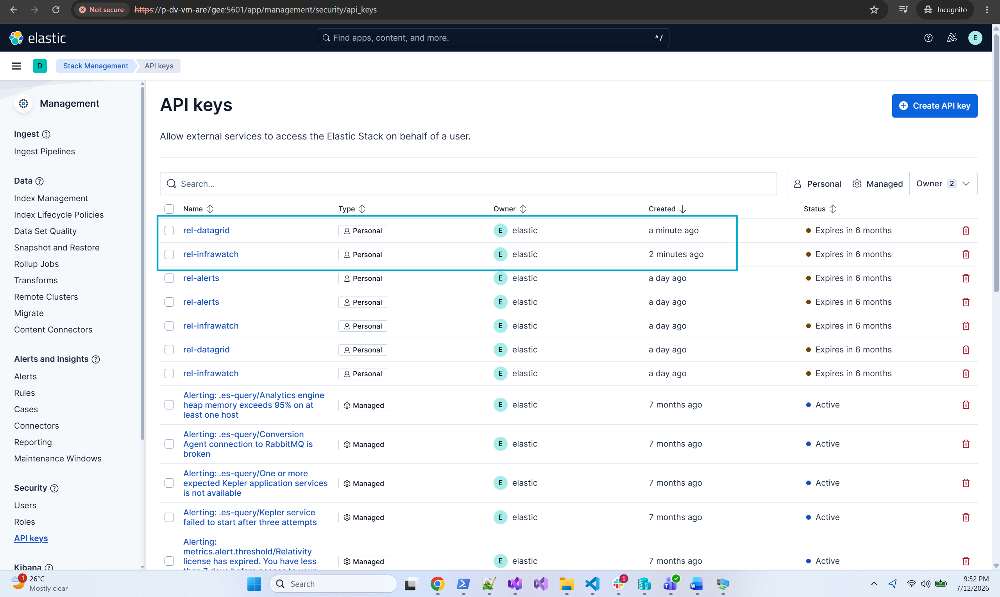
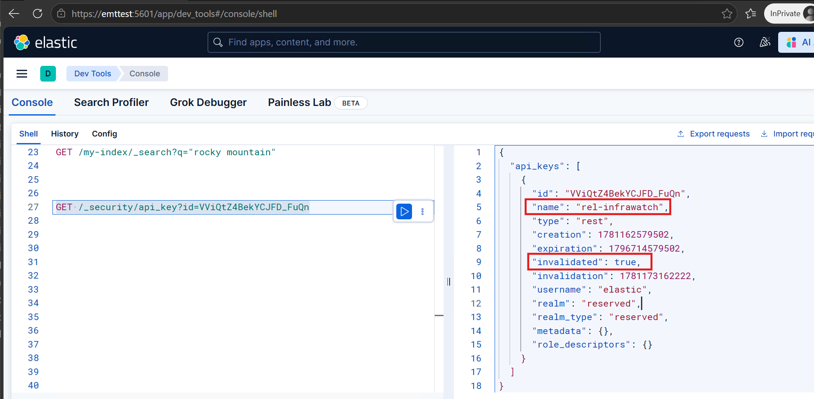
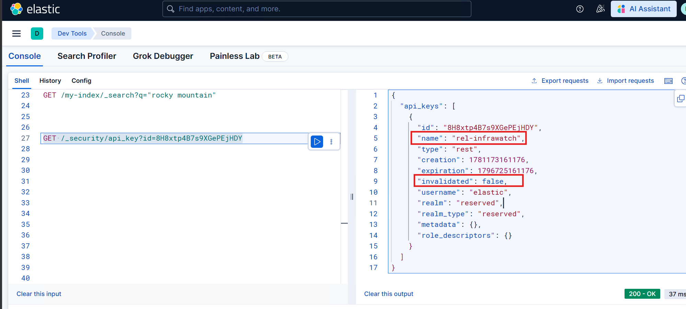

# Rotate an Elasticsearch API Key using the Relativity Server CLI

The `rotate-api-key` command creates new Elasticsearch API keys for the specified cluster, persists them to the Relativity Secret Store, and invalidates the old keys. Run this command periodically to rotate expiring keys or as part of a scheduled security practice.

> [!NOTE]
> It is recommended to run the CLI from the Primary SQL Server.

> This guide assumes the Relativity Server bundle was extracted to `C:\Server.Bundle.x.y.z` or a similar directory chosen by the user.

## Which keys are rotated

Environment Watch setup creates API keys on two Elasticsearch clusters. Each run of `rotate-api-key` targets one cluster and rotates every key on that cluster.

| Cluster | Keys rotated (in this order) | Used by |
|---------|------------------------------|---------|
| `rel-cluster-infrawatch` | `rel-infrawatch`, then `rel-alerts` | `rel-infrawatch`: the Environment Watch monitoring agents. `rel-alerts`: Relativity Alerts |
| `rel-cluster-datagrid` | `rel-datagrid` | Data Grid Audit |

> [!NOTE]
> Rotating the `rel-alerts` key together with `rel-infrawatch` requires Relativity Server CLI version 102.1.46 or later. With earlier versions, `rotate-api-key --cluster rel-cluster-infrawatch` rotates only the `rel-infrawatch` key, and the `rel-alerts` key can only be renewed by running the full Environment Watch setup again.

Each key is rotated on its own: the CLI creates the new key, validates it, invalidates the old key, and saves the new key to the Secret Store before it starts on the next key. If the `rel-alerts` rotation fails, the new `rel-infrawatch` key stays in place and is not rolled back. See [If the rotation fails](#if-the-rotation-fails).

## Prerequisites

- The Server-bundle zip file has been downloaded and extracted to `C:\Server.Bundle.x.y.z`
- Access to the Relativity Secret Store (Whitelisted for Secret Store access. Please see [here](https://help.relativity.com/Server2025/Content/System_Guides/Secret_Store/Secret_Store.htm#Configuringclients) for information on whitelisting.)
- Elasticsearch is running and accessible
- The initial Environment Watch setup has been completed. See [Set up Environment Watch using the Relativity Server CLI](./elastic-stack-setup-02-environment-watch.md)

## Options

| Flag | Short alias | Description | Default |
|------|-------------|-------------|---------|
| `--cluster <value>` | `-c` | Target Elasticsearch cluster. Valid values: `rel-cluster-infrawatch`, `rel-cluster-datagrid`. The `rel-cluster-infrawatch` cluster rotates both the `rel-infrawatch` and `rel-alerts` keys | Prompted interactively |
| `--quiet` | | Suppress confirmation and expiry prompts; auto-confirms with the default 180-day expiry for every key being rotated. Use together with `--cluster` for fully unattended execution. The validity period cannot be changed in quiet mode; to use a different number of days, run the command interactively | `false` |
| `--dryrun` | | Preview what would happen without making any changes to Elasticsearch or the Secret Store | `false` |

## When to rotate

Rotate the keys before they expire. The keys that setup creates are valid for 180 days by default. Environment Watch reports the remaining days for each key and raises the **Elasticsearch API Key – Expiring Within 30 Days** alert when a key has fewer than 30 days left. When this alert appears, run `rotate-api-key` for the cluster that holds the expiring key.

Also rotate a key immediately if you suspect it was exposed. If the `rel-alerts` key expires or is invalidated, Relativity Alerts loses access to Elasticsearch.

## Usage

### Interactive

Running `rotate-api-key` without any flags launches an interactive session. The CLI prompts you to select a target cluster.

```
C:\Server.Bundle.x.y.z\relsvr.exe rotate-api-key

Relativity Server CLI - 102.1.46
Copyright (c) 2026, Relativity ODA LLC

Select the Elasticsearch cluster to rotate the API key for:

> rel-cluster-infrawatch
  rel-cluster-datagrid
```

After selecting a cluster, the CLI displays the ID, name, and number of days remaining before expiry for **each** key it is going to rotate, then asks you to confirm the rotation. Entering `n` aborts with no changes made:

```
Key rotation aborted. No changes were made.
```

Entering `y` continues to prompt for a validity period in days (a whole number of 1 or more), then performs the rotation. The validity period applies to every key that is rotated in the run.

**InfraWatch cluster** (rotates `rel-infrawatch` and `rel-alerts`):

```
Current API key ID: g9tMUp8BVmBEyCHxvRon  (name: rel-infrawatch)
Days remaining before expiry: 179
Current API key ID: hNtMUp8BVmBEyCHxwA3K  (name: rel-alerts)
Days remaining before expiry: 179
Rotate the rel-infrawatch and rel-alerts API keys for cluster 'rel-cluster-infrawatch'? This will invalidate both current keys. [y/n] (n): y
How many days should the new key be valid? (180): 180

API key rotation completed ----------------------------------------- 100%

Successfully rotated the rel-infrawatch and rel-alerts Elasticsearch API keys and persisted the new keys to the Secret Store. Please restart all Relativity services, including "kCura Edds Agent Manager," "kCura Edds Web Processing Manager," and "kCura Service Host Manager" on each server contained within this Relativity instance so that Relativity Alerts uses the new rel-alerts key.
```

Follow the steps in [After the rotation](#after-the-rotation) to finish.

**DataGrid cluster** (rotates `rel-datagrid`):

```
Current API key ID: idtNUp8BVmBEyCHxYC02  (name: rel-datagrid)
Days remaining before expiry: 179
Rotate API key for cluster 'rel-cluster-datagrid'? This will invalidate the current key. [y/n] (n): y
How many days should the new key be valid? (180): 180

API key rotation completed ----------------------------------------- 100%

Successfully rotated the Elasticsearch API key and persisted the new key to the Secret Store. Please restart all Relativity services, including "kCura Edds Agent Manager," "kCura Edds Web Processing Manager," and "kCura Service Host Manager" on each server contained within this Relativity instance to complete the API key rotation.
```

### Rotate with a pre-selected cluster

Use `--cluster` to target a specific cluster directly, skipping the cluster selection menu. The CLI still displays the current key information and asks for confirmation before rotating.

```
C:\Server.Bundle.x.y.z\relsvr.exe rotate-api-key --cluster rel-cluster-infrawatch

Relativity Server CLI - 102.1.46
Copyright (c) 2026, Relativity ODA LLC

Current API key ID: GUgcV58BbZgP437js08h  (name: rel-infrawatch)
Days remaining before expiry: 179
Current API key ID: HEgcV58BbZgP437jtE1m  (name: rel-alerts)
Days remaining before expiry: 179
Rotate the rel-infrawatch and rel-alerts API keys for cluster 'rel-cluster-infrawatch'? This will invalidate both current keys. [y/n] (n): y
How many days should the new key be valid? (180): 180

API key rotation completed ----------------------------------------- 100%

Successfully rotated the rel-infrawatch and rel-alerts Elasticsearch API keys and persisted the new keys to the Secret Store. Please restart all Relativity services, including "kCura Edds Agent Manager," "kCura Edds Web Processing Manager," and "kCura Service Host Manager" on each server contained within this Relativity instance so that Relativity Alerts uses the new rel-alerts key.
```

```
C:\Server.Bundle.x.y.z\relsvr.exe rotate-api-key --cluster rel-cluster-datagrid

Relativity Server CLI - 102.1.46
Copyright (c) 2026, Relativity ODA LLC

Current API key ID: gUkdV58BbZgP437jHQNQ  (name: rel-datagrid)
Days remaining before expiry: 179
Rotate API key for cluster 'rel-cluster-datagrid'? This will invalidate the current key. [y/n] (n): y
How many days should the new key be valid? (180): 180

API key rotation completed ----------------------------------------- 100%

Successfully rotated the Elasticsearch API key and persisted the new key to the Secret Store. Please restart all Relativity services, including "kCura Edds Agent Manager," "kCura Edds Web Processing Manager," and "kCura Service Host Manager" on each server contained within this Relativity instance to complete the API key rotation.
```

Use the `-c` short alias to achieve the same result:

```
C:\Server.Bundle.x.y.z\relsvr.exe rotate-api-key -c rel-cluster-infrawatch
```

### Quiet mode (automated / scripted rotation)

Combining `--quiet` with `--cluster` suppresses all prompts, auto-confirms the rotation, and uses the default 180-day expiry for every key being rotated. This is suitable for scheduled or unattended scripts. Without `--cluster`, the CLI still asks which cluster to rotate.

```
C:\Server.Bundle.x.y.z\relsvr.exe rotate-api-key --quiet --cluster rel-cluster-infrawatch

Relativity Server CLI - 102.1.46
Copyright (c) 2026, Relativity ODA LLC

Current API key ID: 5UkeV58BbZgP437jfiJ8  (name: rel-infrawatch)
Days remaining before expiry: 179
Current API key ID: 6EkeV58BbZgP437jgK2p  (name: rel-alerts)
Days remaining before expiry: 179

API key rotation completed ----------------------------------------- 100%

Successfully rotated the rel-infrawatch and rel-alerts Elasticsearch API keys and persisted the new keys to the Secret Store. Please restart all Relativity services, including "kCura Edds Agent Manager," "kCura Edds Web Processing Manager," and "kCura Service Host Manager" on each server contained within this Relativity instance so that Relativity Alerts uses the new rel-alerts key.
```

```
C:\Server.Bundle.x.y.z\relsvr.exe rotate-api-key --quiet --cluster rel-cluster-datagrid

Relativity Server CLI - 102.1.46
Copyright (c) 2026, Relativity ODA LLC

Current API key ID: gUkdV58BbZgP437jHQNQ  (name: rel-datagrid)
Days remaining before expiry: 179

API key rotation completed ----------------------------------------- 100%

Successfully rotated the Elasticsearch API key and persisted the new key to the Secret Store. Please restart all Relativity services, including "kCura Edds Agent Manager," "kCura Edds Web Processing Manager," and "kCura Service Host Manager" on each server contained within this Relativity instance to complete the API key rotation.
```

The command exits with a non-zero exit code if any key fails to rotate, so a scheduled task can detect a failed run. See [If the rotation fails](#if-the-rotation-fails).

### Dry run

Use `--dryrun` to simulate the rotation without making any changes. The CLI displays the current key information, accepts the same prompts as a normal rotation, then confirms the simulation without writing to Elasticsearch or the Secret Store. A dry run only reads the current state of the keys; it does not create a test key or test the write to the Secret Store, so a successful dry run does not guarantee that the real rotation will succeed.

```
C:\Server.Bundle.x.y.z\relsvr.exe rotate-api-key --cluster rel-cluster-infrawatch --dryrun

Relativity Server CLI - 102.1.46
Copyright (c) 2026, Relativity ODA LLC

Current API key ID: 5UkeV58BbZgP437jfiJ8  (name: rel-infrawatch)
Days remaining before expiry: 179
Current API key ID: 6EkeV58BbZgP437jgK2p  (name: rel-alerts)
Days remaining before expiry: 179
Rotate the rel-infrawatch and rel-alerts API keys for cluster 'rel-cluster-infrawatch'? This will invalidate both current keys. [y/n] (n): y
How many days should the new key be valid? (180): 180
DryRun mode: No changes were committed. The API key rotation was simulated successfully. Both the rel-infrawatch and rel-alerts keys would be rotated.
```

### When no `rel-alerts` key is stored

Some environments have no `rel-alerts` secret in the Secret Store, for example an environment that was upgraded without running the full setup again after the `rel-alerts` key was introduced. In that case, rotating the InfraWatch cluster rotates the `rel-infrawatch` key and **creates** a new `rel-alerts` key, because there is no existing key to invalidate. The CLI tells you before it asks for confirmation:

```
Current API key ID: g9tMUp8BVmBEyCHxvRon  (name: rel-infrawatch)
Days remaining before expiry: 179
No rel-alerts API key was found in the Secret Store. A new rel-alerts key will be created and saved to the Secret Store, because there is no existing key to invalidate.
Rotate the rel-infrawatch API key and create a new rel-alerts API key for cluster 'rel-cluster-infrawatch'? This will invalidate the current rel-infrawatch key. [y/n] (n):
```

When the rotation finishes, the message says that the `rel-alerts` key was created:

```
Successfully rotated the rel-infrawatch Elasticsearch API key, created the rel-alerts Elasticsearch API key and persisted the new keys to the Secret Store. Please restart all Relativity services, including "kCura Edds Agent Manager," "kCura Edds Web Processing Manager," and "kCura Service Host Manager" on each server contained within this Relativity instance so that Relativity Alerts uses the new rel-alerts key.
```

### Invalid cluster value

If an unrecognized value is passed to `--cluster`, the CLI rejects it immediately and lists the valid options.

```
C:\Server.Bundle.x.y.z\relsvr.exe rotate-api-key --cluster infrawatch

Relativity Server CLI - 102.1.46
Copyright (c) 2026, Relativity ODA LLC

Invalid --cluster value 'infrawatch'. Valid values are: rel-cluster-infrawatch, rel-cluster-datagrid
```

## After the rotation

Services keep using the key they already loaded until they are restarted, and the old key is already invalidated. Restart the services below on each server to finish the rotation.

**After rotating `rel-cluster-infrawatch`** (`rel-infrawatch` and `rel-alerts`):

1. Restart all Relativity services, including `kCura Edds Agent Manager`, `kCura Edds Web Processing Manager`, and `kCura Service Host Manager`, on each server in the Relativity instance. Relativity Alerts uses the new `rel-alerts` key after this restart.
2. Restart the **Relativity Environment Watch** Windows service on each monitored server so that the monitoring agent uses the new `rel-infrawatch` key:

    ```powershell
    Restart-Service -Name "Relativity Environment Watch"
    ```

3. Wait 2–5 minutes, then confirm in Kibana that the **Monitoring Agents** dashboard shows hosts reporting. If data does not resume, see [Environment Watch Not Working After API Key Rotation](../troubleshooting/monitoring-agent-and-otel-collector.md#environment-watch-not-working-after-api-key-rotation).

**After rotating `rel-cluster-datagrid`** (`rel-datagrid`):

- Restart all Relativity services, including `kCura Edds Agent Manager`, `kCura Edds Web Processing Manager`, and `kCura Service Host Manager`, on each server in the Relativity instance. If the Audit tab does not load afterwards, see [Data Grid Audit Troubleshooting](../troubleshooting/datagrid-audit-troubleshooting.md).

## Verify the rotation

### Kibana API keys

1. In Kibana, navigate to **Stack Management** > **Security** > **API keys**.
2. Confirm a new key for each rotated key name appears at the top of the list with a recent creation timestamp and an expiry approximately 180 days in the future (or the number of days you entered). After rotating `rel-cluster-infrawatch`, expect a new `rel-infrawatch` key and a new `rel-alerts` key.



### Secret Store

To confirm the new API key was persisted, use the Secret Store CLI to read the secret for the rotated key. To compare values, read the secret both before and after running `rotate-api-key` — the `api-key` value should differ between the two reads.

From an elevated PowerShell on the Secret Store server, navigate to `C:\Program Files\Relativity Secret Store\Client\` and run the read command for each rotated key:

**InfraWatch (`rel-infrawatch`):**

```
.\secretstore.exe secret read /database/elasticsearch/clusters/rel-cluster-infrawatch/security/api-keys/rel-infrawatch
```

**Relativity Alerts (`rel-alerts`, also on the InfraWatch cluster):**

```
.\secretstore.exe secret read /database/elasticsearch/clusters/rel-cluster-infrawatch/security/api-keys/rel-alerts
```

**DataGrid (`rel-datagrid`):**

```
.\secretstore.exe secret read /database/elasticsearch/clusters/rel-cluster-datagrid/security/api-keys/rel-datagrid
```

Each secret contains an `api-key` value (the new encoded key) and a `min-version` value (the Elasticsearch version recorded for the cluster).

### Elasticsearch Dev Tools (optional)

To confirm that the old key has been invalidated and the new key is active, query the Elasticsearch security API in Kibana Dev Tools.

1. In Kibana, navigate to **Dev Tools** > **Console**.
2. To list the active keys by name, run one of the following. After a successful rotation, each query returns only the new key:

    ```
    GET /_security/api_key?name=rel-infrawatch&active_only=true
    GET /_security/api_key?name=rel-alerts&active_only=true
    GET /_security/api_key?name=rel-datagrid&active_only=true
    ```

3. To inspect a specific key, run the following query, replacing `<key_id>` with the ID of the key to inspect. The CLI prints the ID of the key it is about to replace as `Current API key ID`:

    ```
    GET /_security/api_key?id=<key_id>
    ```

4. Verify the results:
    - The old key shows `"invalidated": true`.
    - The new key shows `"invalidated": false`.

**Old key — invalidated:**



**New key — active:**



### Relativity Alerts

After you restart the Relativity services, confirm that Relativity Alerts works with the new `rel-alerts` key:

1. In Relativity, open the **Alerts** tab and the **Logs & Dashboards** tab. The alerts and dashboards from Kibana should load without errors.
2. Optionally, repeat the alert test in [Install Relativity Alerts](./ew-02-relativity-alerts.md#verification) to confirm that a new alert appears in the bell icon flyout.

## If the rotation fails

The CLI exits with a non-zero exit code and writes an error to the console. Because each key is rotated and saved separately, the message tells you which key failed.

**A key could not be rotated** (for example the new key could not be created, validated, or the old key could not be invalidated):

```
ERROR: Failed to rotate the 'rel-alerts' API key: <reason> Keys rotated before this failure are not rolled back. Fix the cause and run 'relsvr rotate-api-key' again. If a new 'rel-alerts' key was created but not saved, delete it in Kibana (Stack Management > Security > API keys).
```

- Keys that were rotated earlier in the same run stay in place. For example, if the `rel-alerts` rotation fails, the new `rel-infrawatch` key is already saved and is not rolled back.
- Fix the cause named in the message (for example, Elasticsearch is not reachable), then run the command again. Running it again rotates the keys again, including the ones that already succeeded.
- If the new key was created but could not be saved, it is not used by anything. Delete it in **Stack Management** > **Security** > **API keys** after you rerun the command, so that only the keys in the Secret Store remain active.

**The new key could not be saved to the Secret Store:**

```
ERROR: Secret Store write failed for the 'rel-alerts' API key. The agent cannot connect until the new key is persisted. New key ID: <key_id>. Run 'relsvr setup' to recover.
```

At this point the old key is already invalidated, so the component that uses it cannot connect until a valid key is saved. Run `relsvr setup` to enter the credentials again and restore connectivity, then confirm that the secret holds the new key as described in [Secret Store](#secret-store).

**The current state of a key could not be read:**

```
Could not retrieve current state: <reason>. Proceed with caution.
```

This is a warning. The CLI could not read the key's ID, name, or remaining days, for example because the stored key is no longer in Elasticsearch. You can still continue with the rotation. If the old key no longer exists in Elasticsearch, the rotation completes and saves the new key.

If the Audit tab does not load after rotating the DataGrid API key, refer to [Data Grid Audit Troubleshooting](../troubleshooting/datagrid-audit-troubleshooting.md).
