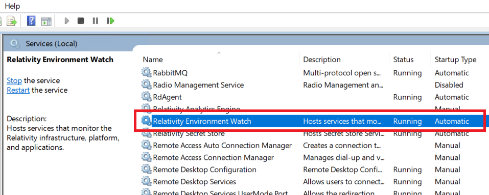
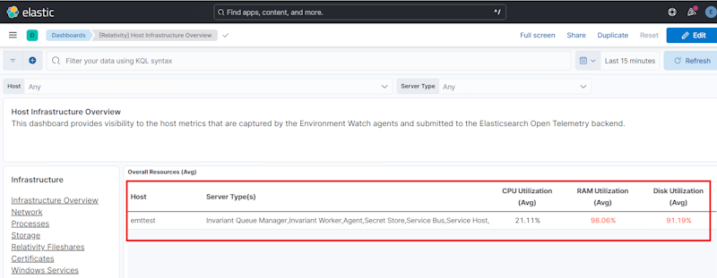
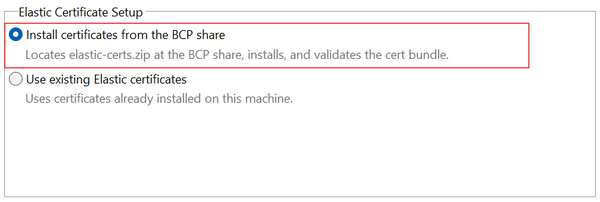
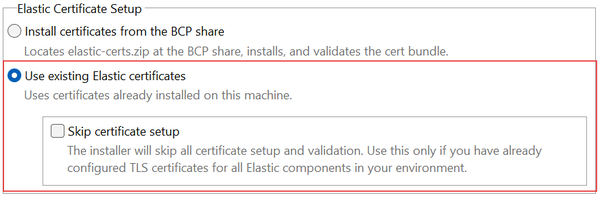
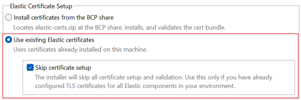

# Install Environment Watch Monitoring Agents

> [!NOTE]
> This step is required for Environment Watch.
> The Environment Watch monitoring agent installation should start on the SQL Primary server, verify the installation, and then be applied to other servers in the environment. This ensures proper setup and validation before deploying across all servers.

This document outlines the steps to install the Environment Watch monitoring agent.

## Prerequisites

- Elastic Stack certificates when you select the default option, **Install certificates from the BCP share**: `elastic-certs.zip` is on the BCP share at `<BCP share>\EnvironmentWatch\`, for example `\\<sql-primary>\BCPPath\EnvironmentWatch\elastic-certs.zip`. To find the BCP path, see [Custom JSON Troubleshooting](../troubleshooting/custom-json-troubleshooting.md).
- Elastic Stack certificates when you select **Use existing Elastic certificates**: the Elastic CA certificate is already installed on the server. See [Elastic certificate setup](#elastic-certificate-setup).
- Access to Elastic Stack, Primary SQL Server, and Secret Store (Whitelisted for Secret Store access. For information on whitelisting, see [Configuring clients](https://help.relativity.com/Server2024/Content/System_Guides/Secret_Store/Secret_Store.htm#Configuringclients).)
- The Server-bundle zip file has been downloaded and extracted to `C:\Server.Bundle.x.y.z`
- Environment Watch has been set up using the Relativity Server CLI
- LDAP port 389 (TCP) must be open from the target server to the domain controller(s), per the [Default Port Reference](../troubleshooting/pre-requisite-troubleshooting.md#default-port-reference) table. The **Environment Watch Installer** uses this port to validate the Relativity Service Account. If the installer fails on this check, see [Domain Controller Unreachable](../troubleshooting/monitoring-agent-and-otel-collector.md#domain-controller-unreachable).
- The Relativity Service Account credentials, if Relativity is not installed on the server or if you want to use a different service account (see step 2 of [Install the Monitoring Agent](#install-the-monitoring-agent)).

## Steps

### Install the Monitoring Agent

1. From the extracted Server Bundle, run `Relativity.EnvironmentWatch.Installer.xx.x.xxxx.exe`. The license page opens.
2. Click **Options** on the license page to open the options page. Click **OK** to save your selections and return to the license page, or **Cancel** to leave the installer. The options page has the following settings:
   - **Installation Folder (optional):** The folder where Environment Watch is installed. Use **Browse** to choose a different folder.
   - **Service Account:** By default the installer uses the Relativity Service Account. To use other credentials, select **Use a custom service account**, then enter the **Username** (`domain\Username`) and **Password**. The fields are enabled only when the option is selected. The service account must be provided here when Relativity is not installed on the host.
   - **Elastic Certificate Setup:** Environment Watch communicates with Elasticsearch, APM Server, and Kibana over TLS, so the server must trust the Elastic CA certificate. This setting controls whether the installer installs the certificate or uses one that is already in place. Choose one of the options described in [Elastic certificate setup](#elastic-certificate-setup).
3. Select **I accept the license terms and conditions**. The **Install** button is disabled until the license terms are accepted.
4. Click **Install**. The installer validates the prerequisites and sets up the Elastic certificates before it installs any file. If a check fails, an error message appears and the installation stops. See the [Monitoring Agent Troubleshooting Guide](../troubleshooting/monitoring-agent-and-otel-collector.md).
5. After the installation completes, click **Close**.

### Verify the Installation

- Open **Services** and verify that the **Relativity Environment Watch** service is running.

  

- Open **Task Manager** and verify that the following processes are running:
  - `rel-envwatch-service.exe`
  - `rel-infrawatch-agent.exe`
  - `otelcol-relativity.exe`
- Verify that new log files are created in the following folder:

  ```
  C:\ProgramData\Relativity\EnvironmentWatch\Services\InfraWatchAgent\Logs
  ```

- Verify that the `otelcol-config-auto-generated.yaml` configuration file is generated in the following folder:

  ```
  C:\ProgramData\Relativity\EnvironmentWatch\Services\InfraWatchAgent\
  ```

### Verify Metrics in Kibana

1. In Kibana, navigate to **Dashboards** and open the **[Relativity] Host Infrastructure Overview** dashboard.
2. Verify that CPU, RAM, and Disk metrics are visible for the newly added host.

   

3. Open the **[Relativity] Monitoring Agent** dashboard and verify the following:
   - The installed monitoring agent version is displayed correctly.
   - Host information and other important fields are displayed correctly.
   - Agent status and health metrics show current data.

### Repeat the Installation on Other Servers

After verifying the first installation, repeat these steps for the remaining servers in the following order:

1. SQL Distributed Servers
2. Web Servers
3. Agent Servers
4. Other Servers (for example, File Share, Analytics, and Worker servers)

> [!NOTE]
> For troubleshooting, refer to the installer logs in the `%TEMP%` directory or see the [Monitoring Agent Troubleshooting Guide](../troubleshooting/monitoring-agent-and-otel-collector.md).

## Elastic certificate setup

The installer can install the certificate authority (CA) certificate for you, or use certificates that are already in place. Select one of the following options in the **Elastic Certificate Setup** section of the options page.

### Options overview

- `elastic-certs.zip` is on the BCP share (generated with `relsvr.exe generate-certs`, or with `relsvr.exe install` for a multi-node Elastic Stack): keep the default, **Install certificates from the BCP share**.
- The Elastic CA certificate is already installed on this server (for example, by your own automation), or `elastic-certs.zip` is not available (for example, the Elastic Stack was installed in the default all-in-one mode, which does not produce this file): select **Use existing Elastic certificates**.
- You have already configured TLS for all Elastic components and do not want the installer to validate the Elastic Stack: select **Use existing Elastic certificates**, then **Skip certificate setup**.

| Option | What the installer does | Registry result |
|---|---|---|
| **Install certificates from the BCP share** (default) | Reads `elastic-certs.zip` from `<BCP share>\EnvironmentWatch\`, copies `ca.crt` to the Elasticsearch, APM Server, and Kibana certificate folders, and imports it into the **Local Machine > Trusted Root Certification Authorities** store. Then validates the Elastic Stack connection over TLS. | `ConfiguredBy=ZipInstalled` |
| **Use existing Elastic certificates** | Does not install any certificate. Validates the Elastic Stack connection over TLS. | `ConfiguredBy=External` |
| **Skip certificate setup** (appears only when **Use existing Elastic certificates** is selected) | Skips all certificate setup and the Elastic Stack validation. | No registry entry is written |

### Install certificates from the BCP share (default)

When this option is selected, the installer copies `ca.crt` to:

| Component | Destination |
|---|---|
| Elasticsearch | `C:\elastic\elasticsearch\config\certs\http_ca.crt` |
| APM Server | `C:\elastic\apm-server\certs\ca.crt` |
| Kibana | `C:\elastic\kibana\config\certs\ca.crt` |

> [!IMPORTANT]
> The installer aborts if `elastic-certs.zip` is not found at `<BCP share>\EnvironmentWatch\`, if it cannot determine the BCP share path of the Relativity SQL Primary server, or if the archive is not valid.



### Use existing Elastic certificates

Select this option when the Elastic CA certificate is already installed on the server. The installer does not install any certificate.



### Skip certificate setup

The **Skip certificate setup** check box appears only after you select **Use existing Elastic certificates**. Select it to skip all certificate setup and the Elastic Stack validation. Use it only if TLS is already configured for all Elastic components.



## Next Step
[Click here for the next step](./ew-02-relativity-alerts.md)
