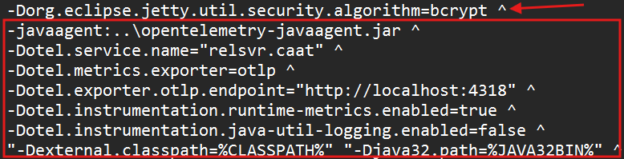

# Setting Up OpenTelemetry Java Agent for Relativity Analytics Engine (CAAT)


This guide provides step-by-step instructions for installing/updating Relativity Analytics Engine (CAAT) along with the OpenTelemetry Java Agent. This enables distributed tracing and observability with minimal code changes.

For other integrations, refer to the [Environment Watch Install other Integrations Guide](./ew-03-extensibility-configuration.md).

## CAAT version by Server version

Use the CAAT version that matches your Relativity Server version.

| Relativity Server version | CAAT version |
|---|---|
| Server 2026 | 26.0.46.A1 |
| Server 2025 & Server 2024 | 5.1.8.A1 |

## Why use opentelemetry-javaagent?

- **Automatic Instrumentation:** The OpenTelemetry Java Agent automatically instruments supported libraries and frameworks, capturing telemetry data (traces, metrics, logs) without code changes.
- **Observability:** It provides deep visibility into application performance, dependencies, and bottlenecks.
- **Standardization:** OpenTelemetry is a vendor-neutral standard, ensuring compatibility with various observability backends (e.g., Azure Monitor, Jaeger, Zipkin).

## Why Auto-Instrumentation is safe

- **Non-Intrusive:** The agent works by attaching to the JVM at startup, using bytecode manipulation. It does not require code changes or recompilation.
- **Widely Adopted:** OpenTelemetry Java Agent is used in production by many organizations and is actively maintained.
- **Configurable:** Instrumentation can be enabled/disabled for specific libraries, and the agent can be removed by simply omitting the `-javaagent` flag.
- **No Persistent Changes:** The agent does not persistently modify your application or its dependencies.

## How to install/update CAAT

### Prerequisites

- CAAT installer package for your Server version (see the version table above; for Server 2026, use CAAT 26.0.46.A1)
- Administrative access to the server

### Installation Steps

1.  Install or upgrade to the CAAT version listed for your Server version in the version table above (for Server 2026, CAAT 26.0.46.A1). If this has already been completed, skip this step.
2.  Ensure no analytics jobs are currently running, then stop the **Relativity Analytics Engine** service
3.  Stop the **Relativity Environment Watch** service on the analytics server.
4.  Open the `startup.cmd` file in the `bin` directory of the installed CAAT application in a text editor running as administrator.
5.  Add the following lines directly below the `-Dorg.eclipse.jetty.util.security.algorithm=bcrypt ^` line, as shown in the image below, and save the file. These lines enable the OpenTelemetry Java Agent to collect telemetry data from the CAAT service. The `-javaagent` line references `opentelemetry-javaagent.jar`, which is provided by the CAAT installer package:

    ```
    -javaagent:..\opentelemetry-javaagent.jar ^
    -Dotel.service.name="relsvr.caat" ^
    -Dotel.metrics.exporter=otlp ^
    -Dotel.exporter.otlp.endpoint="http://localhost:4318" ^
    -Dotel.instrumentation.runtime-metrics.enabled=true ^
    -Dotel.instrumentation.java-util-logging.enabled=false ^
    ```

    

6.  Once the file is saved, start the **Relativity Analytics Engine** and **Relativity Environment Watch** services and verify the engine is active
7.  Open Kibana and search for `service.name: "relsvr.caat"` in the `metrics-*` data view to confirm telemetry is being collected


## How to verify the changes

1. **Check Application Logs:** On startup, the agent logs its initialization. Look for lines mentioning `opentelemetry-javaagent` in the CAAT logs.
2. **Verify Telemetry Export:** Confirm that traces and metrics are being sent to your configured backend (e.g., OpenTelemetry Collector, Jaeger, Azure Monitor).
3. **Check Service Name:** Ensure the service appears as `Relativity Analytics Engine` (or your configured name) in your observability backend.
